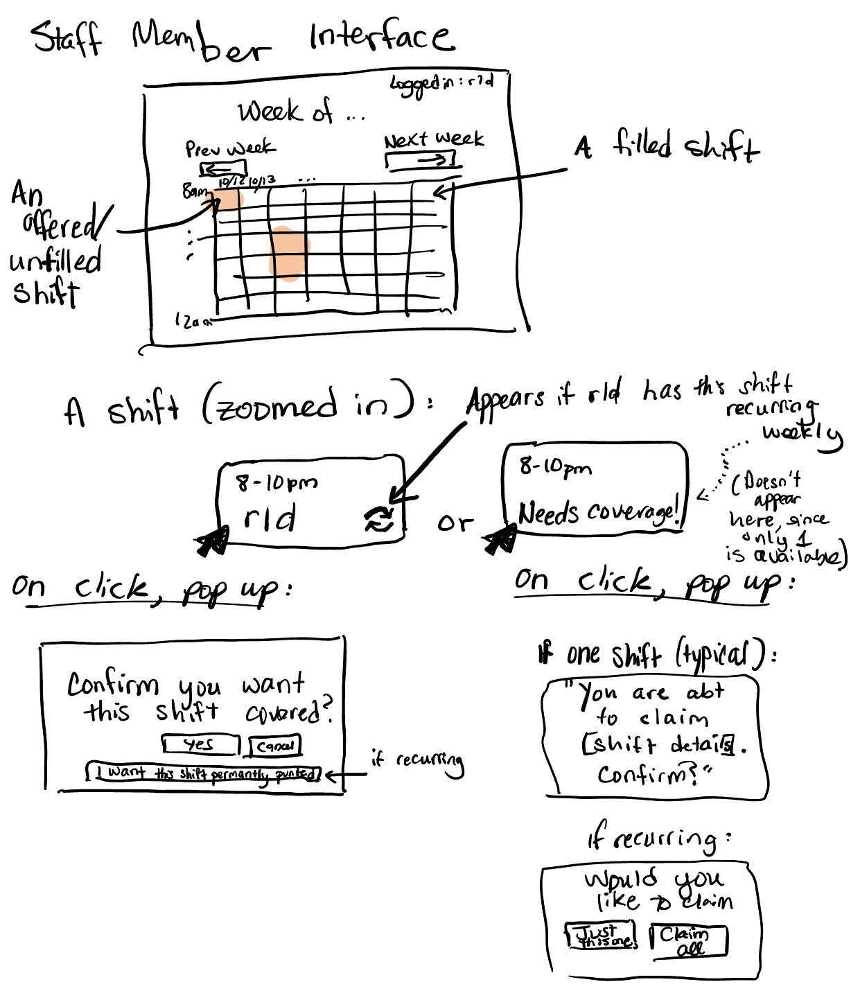
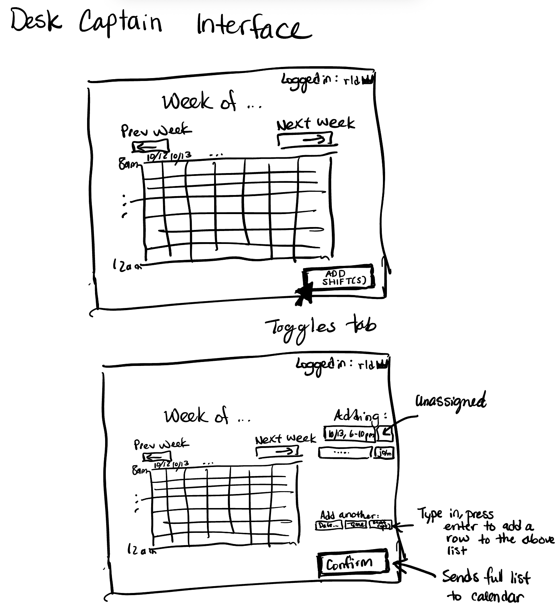

# Problem framing

## Domain

In East Campus's mail desk (also called "FRED DESK"), student desk staff are assigned weekly shifts. Sometimes, for various reasons, desk staff are no longer able to work a certain shift. The current protocol is to make a thread in Discord (the primary method of communication between desk staff) stating what shift the staff member is unable to work and requesting coverage. Then, another staff member will reply to that thread claiming the shift. Sometimes, the staff member wants to swap rather than simply give up the shift (so that they still get income), so staff members may discuss a trade instead.

At the same time, desk staff have access to a Google Calendar with who is working when. This is used when someone does not show up to a shift, so the mail desk captain or current staff member can check in and ask if they are still coming (otherwise, everyone will be pinged in hopes someone else can cover). The mail desk "captain" (another student worker who acts as a team manager) is responsible for updating the Google Calendar whenever people swap shifts.

## Bad situations

Updating the calendar manually to match the swapped shifts is tedious, especially during certain weeks of the semester that have many trades. This tediousness leads to the calendar not getting updated at all, thus becoming an unreliable source of information. This produces uncertainty as to who is supposed to be working.

Relatedly, when many shifts need coverage, the threads can get cluttered. This can make it unwieldly for staff to sift through and determine which shifts they can and want to cover, which is both unpleasant and a deterrant from them picking up shifts at all.

TODO: Feedback from E1: Pull those viv moments (showing up the wrong shift etc.) into the bad situations section. (What viv moments? Those in Corroboration?)

## Stakeholders

**Desk staff**: The students working the mail desk, who yield and pick up shifts.

**Desk captain**: A desk staff member who, in addition to desk staff responsibilities, acts as a "team leader" to the rest of the desk staff. This includes scheduling regular shifts and ensuring that desk is open during the hours it is supposed to be open, i.e. there are staff scheduled and staff show up for their assigned hours.

**Residents**: Those living in the dormitory, who expect the desk to be open at predictable hours. Unexpected closures cause inconveniences to residents.

## Corroboration

I personally have decided not to pick up shifts, and then scheduled conflicting things during that time, because too many threads were open and I was unable at the moment to go through each thread to see what is needed.

I have shown up to a shift that I thought I was working, only to find that it was not my shift.

This past summer, I worked mail desk and the calendar was rarely updated. Instead I would assume the next shift was whoever was typically scheduled for that shift, or I would try to look through the threads to find if it was swapped. Sometimes, my guess would be wrong and that person would either respond "not my shift" or not respond at all, even though the relevant person was in fact planning to work, I just could not tell who it was.

I have witnessed my coworkers also be unable to tell who will be working, or ping the wrong person.

This semester, there have been instances of people forgetting and missing shifts. This is a different problem, but this could make it a little easier to find your shifts without remembering them.

## Workarounds and comparables

If the calendar is not updated at all, there are two current workarounds:

1. Assume the regularly-scheduled person will be the person working. Shifts can change frequently, especially during busy weeks of the semester, so these assumptions are often wrong.
2. Search through the Discord threads to see if the shift was swapped. The search function on Discord threads does not work as smoothly as one would expect with dates, especially because threads will archive themselves after some time. Therefore, it is hard to be sure whether there was a swap at all, and if the staff member does find a thread, it may take some unecessary time and effort to do so.

If the calendar is updated, this works for the desk staff, but is tedious and potentially error-prone to the desk captain. Additionally, there are still delays between the shift being swapped and the calendar being updated by the desk captain.

There are commercial HR apps such as Dayforce that handle shift swapping and other functions. However, these can be overkill for a variety of reasons:

- They are typically paid apps, which is not a worthwhile cost for a small team like FRED DESK (currenty 18 staff members).
- They do not integrate natively with the current systems that FRED DESK currently uses (Discord, Google Suite), which are selected specifically because they are easy to use, familiar to most desk staff, and already part of many staff's daily operations (a.k.a. it is easy for desk staff to check the FRED DESK Discord channels when they are already using Discord for other daily operations).

## Solution sketch

A webapp interface displaying the current schedule. The calendar is first populated by the desk captain, typically with recurring shifts (e.g. a weekly schedule) or empty (up for grabs) slots. Staff can mark their own shifts as needing coverage, and can claim any shifts that need coverage.

# Application pitch

**Shift Market** simplifies your team's shift economy. No longer will your staff need to sift through a wall of text conversation to determine what shifts need coverage and whether they've been covered yet. **Shift Market** offers:

1. **Shift swaps**: When staff members wish to give up a particular shift, they can simply click on their shift and confirm they would like coverage. Likewise, staff members can click to claim available shifts. This makes the process smooth and easy.

2. **Shift assignments**: Of course, staff must first have shifts in order to give them up! The desk captain has additional priviledges to create recurring or standalone shifts, which can either be assigned to staff* or listed as available.

3. **Live notifications and reminders**: This app would not be competitive if it did not notify staff as soon as shifts become available, especially when it comes to shifts coming up very soon. Shift Market offers functionality to send Discord messages that tag the relevant role when new shifts become available. If shifts are unfilled within 2 hours of that shift's start, a message that tags everybody will be sent.

*The desk captain can assign shifts to staff even if the staff have not created an account yet.

# Concept design

Desk captain creates shifts through *Provisioning*. Staff and desk captain can claim and assign (respectively) shifts using *Reserving*, using StaffMember as the User and Shift as the Resource.

Staff can use *Offering* to offer their shift for others to cover. Once someone agrees, the offer can be closed and *Reserving* is then used to reassign the reservation to the new staff member.

*Expiring* is used to track when to send a ping (2 hours before a shift). The computer will create an expiration when an offer is put up, which will be associated with a timer. When the timer goes off, it will trigger *Expiring.expire*, which in turn triggers a Discord POST request to be sent.

## Concepts

### Provisioning

```
concept Provisioning

purpose provision time slots (shifts) for filling in advance

principle shifts can be made

state
  a set of Shifts with
    a start Time
    an end Time
    a Date
    an optional set of linked Shifts

actions
  makeShift (start: Time, end: Time, date: Date) : (shift: Shift)
    where start < end
    then create a new shift with the given parameters and return it

  makeWeeklyShift (start: Time, end: Time, day: number, first: Date, last: Date) : (shifts: set of Shift)
    where start < end, first <= last
    then call makeShift to create new shifts, one for each week between first and last (inclusive),
    with each's linked Shifts containing all other shifts created in this call.
    create a set with all the newly-created shifts and return it
```

### Reserving

```
concept Reserving [User, Resource]

purpose secure future access to a limited resource

principle a user can reserve a resource for future use,
  then users cannot reserve that resource
  unless the reservation has been canceled

state
  a set of Reservations with
    a User
    a Resource

actions
  reserve (user: User, resource: Resource) : (reservation: Reservation)
    where resource is not in Claimed or Reservations
    then create a Reservation with user and resource,
    add it to Reservations, and return it
  
  cancel (reservation: Reservation)
    then cancel the reservation by deleting it from Reservations
```

### Offering

```
concept Offering [User, Item]

purpose unwanted items can find users who want them

principle Users and non-users (e.g. computer) can offer up items,
  which can then be claimed by users.

state
  an set of Offers with
    an optional current owner User
    an Item
  a Claimed set of Offers

actions
  offer (item: Item, user?: User) : (offer: Offer)
    where there is no current unclaimed offer with this item
    then create a new offer with user and item
  
  claim (user: User, offer: Offer)
    where offer exists in Offers and is not claimed
    then add offer to Claimed
    
  _hasOffer (item: Item) : (hasOffer: boolean)
    where item is in Offers
    then return true
    
  _getOffer (item: Item) : (offer: Offer)
    where item is in Offers
    then return that Offer
```

### Expiring

*Timer will be replaced with the appropriate class at the implementation stage.*

```
concept Expiring [Item, Timer]

purpose take action after a certain amount of time

principle add an item and a duration of time. this can be canceled. if it
  is not canceled by the time that duration passes, resolve that item.

state
  a set of Expirations with
    an Item
    an end DateTime
    a Timer

actions
  schedule (item: Item, end: DateTime, timer: Timer) : (expiration: Expiration)
    then create a new Expiration with item, end, and Timer and return it

  cancel (expiration: Expiration)
    where the expiration exists in Expirations
    then cancel the timer and remove the expiration from Expirations

  expire (expiration: Expiration) : (item: Item)
    where an Expiration's time is now or in the past
    then remove the Expiration and return the item
    
  _getExpirationForItem (item: Item) : (expiration: Expiration)
    where item is in Expirations
    then return the relevant Expiration
    
  _getExpirationForTimer (timer: Timer) : (expiration: Expiration)
    where timer is in Expirations
    then return the relevant Expiration
```

## Reactions

*Timer will be replaced with the appropriate class at the implementation stage.*

```
reaction setUpNewShift
  when Provisioning.makeShift (start, end, date) : (shift)
  then Offering.offer (shift) : (offer)
```

```
reaction scheduleOfferExpiry
  when Offering.offer (shift) : (offer)
  then Expiring.schedule (item: shift, shift.end - 2 hours, timer: new Timer()) : (expiration)
```

```
reaction expireOffers
  when Expiring.expire (expiration) : (item: shift)
  where Offering._hasOffer (item: shift)
    and Offering._getOffer (item: shift) : (offer)
  then send POST request to Discord channel with a message notifying
    people the upcoming shift still needs coverage
```

```
reaction timerStarts
  when Expiring.schedule (shift, end, timer) : (expiration)
  then expiration.timer.set(end)
    # or whatever starts the timer with the specified time

reaction timerEnds
  when timer ends
  where Expiring._getExpirationForTimer (timer) : (expiration)
  then Expiring.expire(expiration)
```

```
reaction claimOffer
  when Offering.claim (user, offer)
  where Reserving._reservationFor (offer.shift) : (reservation)
    and Provisioning._isFull (offer.shift)
  then Reserving.cancel (reservation)
    and Reserving.reserve (user, offer.shift)
  where Reserving._hasReservation (offer.shift) : false
  then Provisioning.fill (offer.shift)
    and Reserving.reserve (user, offer.shift)
```

```
reaction permissions
  when Requesting.request (action: offer, item: shift)
  where Authenticating._loggedIn : (user)
    and Reserving._getReservation (item: shift) : (reservation)
    and reservation.user == user
  then Offering.offer (item: Item, user?: User) : (offer: Offer)
```

and other similar access gating and other stuff.

# UI Sketches

## Staff Members



## Desk Captain



# User journey

Fionna (kerb fionna) is a desk staff member who has weekly shifts on Monday, Wednesday, and Fridays from 6-10pm (technically 2 shifts each day, as our shifts are in 2-hour blocks). She planning to be out of town on Friday 10/16, so she needs someone to cover her shift. She opens Shift Market and logs in, landing on the calendar page which is the dashboard for staff members. She clicks her Friday shift, and confirms that she wants this shift covered (for this date only).

Because she will be losing 4 hours of pay, she is wondering if there are other shifts that she can use to make up the pay she would normally be earning. She clicks to view "Next week," which shows the next week's calendar. It is mostly the same as the previous weeks, though some shifts look different.

She notices that 10/22 12-2pm is available, which is perfect for her schedule, so she clicks that shift and then confirms she would like to claim it.

A few days later, she has to cancel her 10/16 trip due to weather. On the schedule, 6-8 was claimed, but 8-10 was not. She clicks 8-10 to claim the shift she previously yielded.

She then gets notified by two Discord notifications.

The first, in #announcements, is from the Desk Captain, notifying her that Thanksgiving week will be scheduled differently since many staff members will be traveling. She opens Shift Market and goes to that page, which is completely empty, with reduced hours (8am-8pm instead of 8am-12am). She claims a few shifts since she is not traveling for Thanksgiving.

The second, in #shifts-swap, is from Shift Market. It says that the shift in 1 hour is still not claimed, and needs coverage. She opens Shift Market again, though sees that Cake has already claimed that shift while she was looking at Thanksgiving.

The next week, Fionna is feeling very ill leading up to her shift. She offers her upcoming shift on Shift Market. Because the shift is 115 minutes away, she gets a Discord notification from Discord in the #shifts-swap channel, that has tagged all desk staff asking if someone can cover on late notice.
